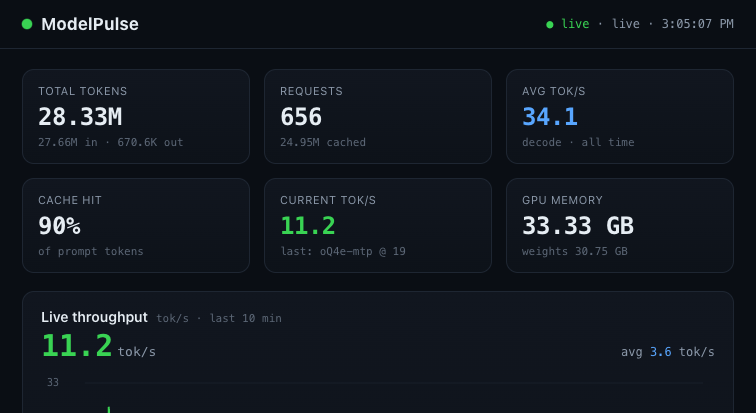

# ModelPulse

[](https://opensource.org/licenses/MIT)


A local LLM usage dashboard for **oMLX + Hermes Agent** — live throughput, persistent heatmaps, per-model stats, and memory/context attribution. Built to be better than the stock oMLX dashboard, with its **own persistent database** so history survives oMLX's 90-day stats rotation.



## What it shows

| Panel | What | Source |
|---|---|---|
| **Stat cards** | **total tokens** (In / Cached / Out / Think breakdown), requests, avg tok/s, cache hit, **current tok/s**, GPU memory | oMLX + Hermes + live sampler |
| **Token usage** | **In / Cached / Out / Think** bars + **live session counter** | oMLX `stats.json` + Hermes `state.db` |
| **Stats** | **live** (tokens/min, active requests, TTFT, peak tok/s) + **lifetime** (tokens today/week, cache savings, reasoning ratio, peak day, generation time, cost) | oMLX + Hermes (persisted) |
| **Live throughput** | tok/s over the last 10 min with a **dashed average line** | oMLX server log (per-request) |
| **Memory** | model weights, headroom, live OS wired, **context-window %** + what's using it | Splash `/health` + `vm_stat` + Hermes sessions |
| **Usage heatmap** | GitHub-style day grid (90 days) + hour-of-day strip | oMLX `usage.sqlite3` (persisted) |
| **Models** | per-model requests, tokens, tok/s, cache hit | oMLX `stats.json` (persisted) |
| **Sessions** | Hermes sessions with token attribution | Hermes `state.db` (persisted) |
| **Recent requests** | live per-request feed (model, prompt, out, tok/s, TTFT, finish) | oMLX `server.log` (tailed) |

## The universal design

Token usage is sourced from **oMLX** (the OpenAI-compatible server on `:8000`), which every local-model harness — Hermes, Codex, Claude Code, Aider, … — flows through. So ModelPulse does **not** need to query each harness for tokens; one source covers all of them.

Attribution ("what is using it") is sourced from each harness's session store. **Hermes** (`~/.hermes/state.db`) is wired now. To add another harness later, add an ingester that copies its session table into `pulse.db` — the token side already works because it goes through oMLX.

## Own persistent storage

`~/modelpulse/pulse.db` (SQLite) ingests from the sources above and accumulates forever. oMLX deletes its own stats after 90 days; ModelPulse's copy does not.

Tables: `requests`, `hourly_usage`, `model_totals`, `sessions`, `snapshots`, `meta`.

## Token accounting (what the counter actually shows)

The main **Total tokens** counter and the **Token usage** panel break usage into four parts, because a single "total" hides what's happening:

| Part | Meaning | Source |
|---|---|---|
| **In** | fresh input tokens actually sent to the model (`prompt − cached`) | oMLX `stats.json` |
| **Cached** | prompt tokens served from the KV cache (cheap, not re-prefilled) | oMLX `stats.json` |
| **Out** | tokens generated — the response **including** thinking | oMLX `stats.json` |
| **Think** | reasoning/thinking tokens (a subset of Out) | Hermes `state.db` |

`Total = In + Cached + Out`. **Think** comes from the Hermes session store (oMLX doesn't separate reasoning from completion), so it reflects the active Hermes profile. The **live session counter** shows the currently-active session's In / Out / Think, updating as it runs.

> Why the old counter looked "wrong": it showed `prompt + completion` with a single "in / out" line. Most of the "in" is **cached** prompt tokens, and the "out" bundled thinking in without saying so. The breakdown above makes both explicit.

## Quick Start

### Prerequisites

- **macOS** (uses `launchd` for auto-start)
- **Python 3.14+** (ships with macOS)
- **oMLX** running locally (OpenAI-compatible server on port 8000)
- **Hermes Agent** with an active profile

### Install & Run

```bash
cd ~/modelpulse

# Quick start — runs in foreground (Ctrl-C to stop)
./run.sh

# Or run as a background daemon
./run.sh start

# Check everything is wired up correctly
./run.sh check
```

Open **http://127.0.0.1:8787** in your browser.

### Auto-start (survives reboot)

```bash
./run.sh install    # installs launchd agent
./run.sh uninstall  # removes it
```

### Daemon commands

```bash
./run.sh start      # start background daemon
./run.sh stop       # stop the daemon
./run.sh status     # show running status
```

## Configuration

All source locations are configurable. Defaults match the standard oMLX + Hermes layout, so it works out of the box.

```bash
./run.sh config     # show config path + open in editor
./run.sh check      # verify every path resolves + Splash is reachable
```

Edit **`config.json`** directly or use the web settings page at **http://127.0.0.1:8787/settings**.

### Key settings

| Key | Default | When to change |
|---|---|---|
| `omlx_home` | `~/.omlx` | oMLX installed elsewhere |
| `hermes_state_db` | `auto` | Different Hermes profile → `~/.hermes/profiles/<name>/state.db` |
| `splash_url` | `http://localhost:8000` | oMLX server on another port/host |
| `port` | `8787` | Dashboard port clash |
| `db_path` | `~/modelpulse/pulse.db` | Where to store the persistent DB |
| `sample_interval` | `2.0` | Seconds between live samples |
| `live_window` | `600` | Live chart window in seconds |

**Precedence:** CLI flag > env var > `config.json` > defaults.

**Environment variables:** `MODELPULE_PORT`, `SPLASH_URL`, `OMLX_HOME`, `OMLX_LOG`, `OMLX_USAGE_DB`, `OMLX_STATS`, `HERMES_STATE_DB`, `MODELPULE_DB`.

After editing, reload: `./run.sh stop && ./run.sh start` (or `./run.sh config` to edit + reload).

Run `./run.sh check` first — it prints `[OK]`/`[MISS]` for every source so you know exactly what's wired up.

## Settings Page

Open **http://127.0.0.1:8787/settings** (or the ⚙ Settings link in the header) to point ModelPulse at your setup without editing JSON by hand:

- **Data sources** — live OK/MISS status for every path (oMLX log, usage DB, stats, Hermes state.db, own DB, Splash `/health`)
- **Configuration** — edit source paths, Splash URL, port, and sampler cadence. **Save & Apply** writes `config.json` and reloads it **live** (no restart needed for path/URL/cadence changes)

## API

| Endpoint | Description |
|---|---|
| `GET /api/summary` | Totals + current tok/s + memory |
| `GET /api/live?window=600` | tok/s time series + window average |
| `GET /api/heatmap?days=90` | Day→hour token grid |
| `GET /api/models` | Per-model cumulative stats |
| `GET /api/requests?limit=50` | Recent per-request records |
| `GET /api/sessions` | Hermes sessions (active + recent) |
| `GET /api/memory` | Memory breakdown + context window |
| `GET /api/tokens-live` | In / Cached / Out / Think breakdown |
| `GET /api/stats` | Live + lifetime stats |
| `GET /api/config` | Current config + per-source status |
| `POST /api/config` | Validate + write `config.json` |
| `POST /api/config/reload` | Re-read `config.json` and apply live |

## Files

| File | Description |
|---|---|
| `modelpulse.py` | Collector + log tailer + ingesters + HTTP API (stdlib only, no deps) |
| `dashboard.html` | The frontend (vanilla JS + Canvas, no build step) |
| `settings.html` | The settings page (edit source paths + apply live) |
| `config.json` | Your settings (source paths, port). Auto-created, self-documenting |
| `pulse.db` | Persistent SQLite (auto-created, not tracked in git) |
| `run.sh` | Launcher / launchd installer |

## Notes / Honest Caveats

- **Current tok/s** is the decode speed of the most recent completed request, exponentially decayed toward 0 when idle (τ = 8 s). It spikes when a request finishes and settles to 0 between requests — that's the real signal, not a bug.
- **Context window %** = the most active session's input tokens ÷ the model's `max_model_len`. The KV-memory figure is an estimate.
- **OS wired** (`vm_stat`) is a live GPU-memory-pressure gauge; it can read slightly below Splash's reported model-weight figure because MLX's Metal allocations don't all map 1:1 to "wired" pages.

## License

**MIT License** — see [LICENSE](LICENSE) file.

Free to use, modify, and distribute. Attribution appreciated but not required.

---

Built for **oMLX + Hermes Agent** on macOS. No external dependencies — pure Python stdlib + vanilla JS.
